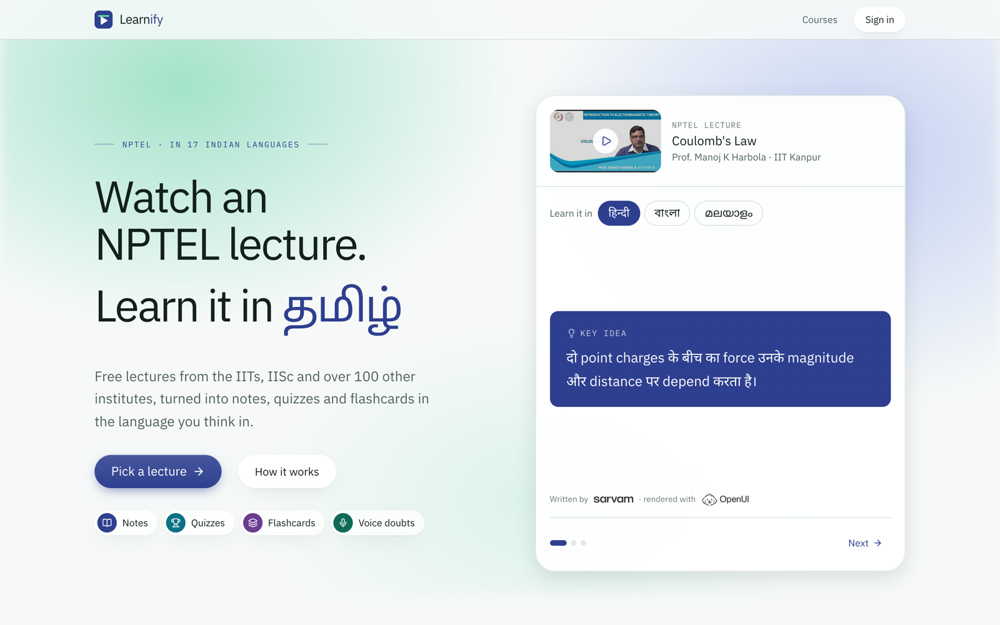
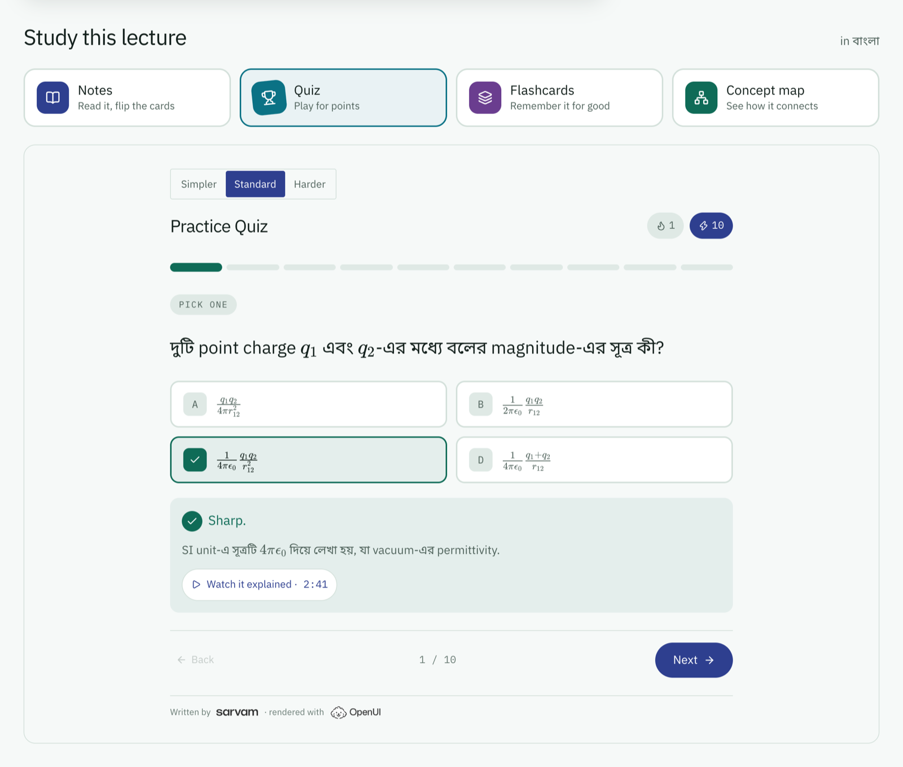
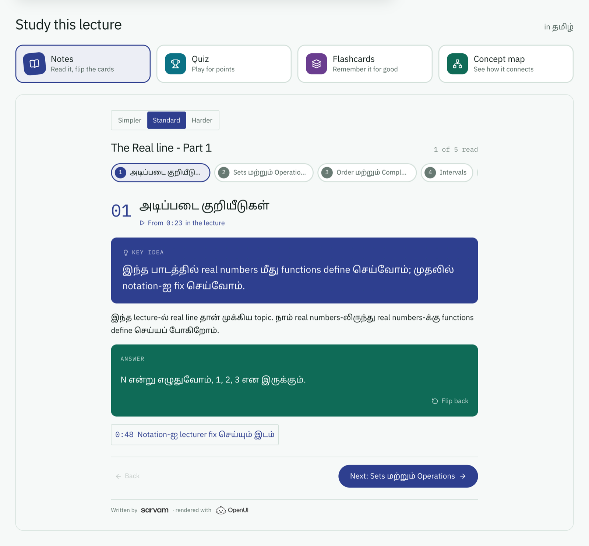
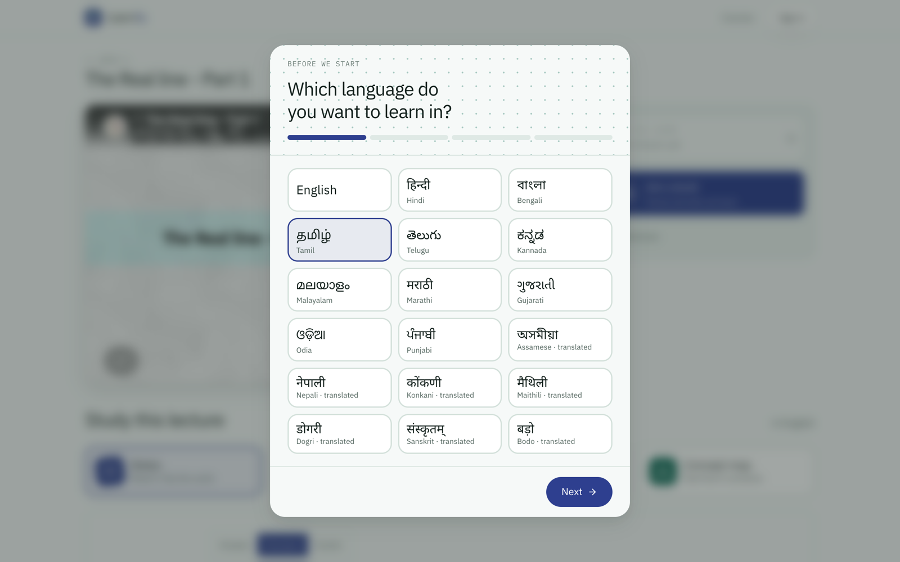
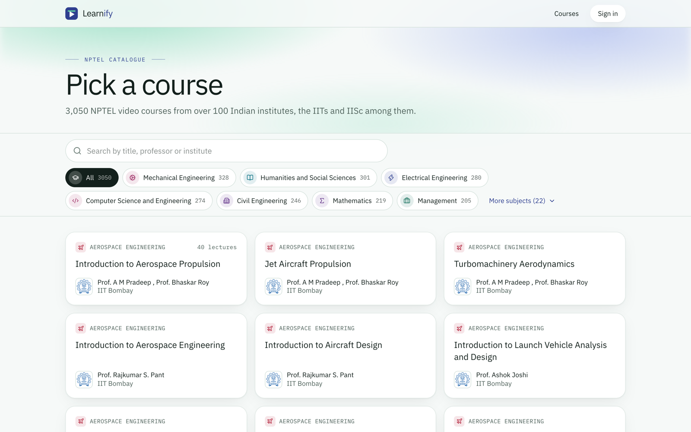

# Learnify

**Watch an NPTEL lecture. Learn it in your language.**

Pick any of 3,050 free [NPTEL](https://nptel.ac.in) courses from the IITs, IISc and over 100 other institutes. The lecture plays as it was recorded; Learnify writes notes, quizzes and flashcards from it in 17 Indian languages, and answers spoken doubts from what the lecturer just said.



| Quiz, in Bengali | Notes, in Tamil |
| --- | --- |
|  |  |
| **Four-tap setup** | **3,050 courses** |
|  |  |


## What it does

- **Interactive notes:** chapters with key ideas, worked examples and flip cards.
- **Quizzes that play like a game:** five question types, streaks and points. Every answer key is checked against the lecture before it's saved.
- **Flashcards and a concept map**, with spaced review.
- **Doubts by voice:** pause, ask in your language, get an answer grounded in that moment of the lecture.
- **Nothing is generated until you ask**, and everything generated is saved and shared with the next student.

## How it's built

- **Next.js 15**, TypeScript, Tailwind v4, Supabase (Postgres and Auth) via Drizzle.
- **[Sarvam AI](https://www.sarvam.ai):**
  - `sarvam-105b` writes notes, quizzes and answers, and checks quiz keys;
  - Sarvam-Translate covers Assamese, Nepali, Konkani, Maithili, Dogri, Sanskrit and Bodo;
  - Saaras turns speech into text, Bulbul reads answers aloud.
- **[OpenUI](https://www.openui.com):** the model writes OpenUI Lang against Learnify's own components (`src/lib/openui`), validated before it's stored.
- **Lectures:** NPTEL's course data and captions, played in YouTube's embedded player.

## Run it

You need Node 20+, a [Supabase](https://supabase.com) project and a [Sarvam](https://dashboard.sarvam.ai) API key.

```bash
OPENUI_TELEMETRY_DISABLED=1 npm install
```

```bash
cp .env.example .env
```

Fill in `.env` (each variable says where to find it), enable Google sign-in in Supabase, and add `http://localhost:3000/auth/callback` to its redirect URLs. Then:

```bash
npm run db:migrate
```

```bash
npm run dev
```

## Test it

```bash
npm test
```

```bash
npm run typecheck
```

```bash
npm run lint
```

The tests cover the API routes, NPTEL decoding, the Sarvam client, translation, generated-screen checks and answer-key fixes, and that every table has row-level security. `GET /api/health` reports which settings a deployment is missing.

## Licence of the content

Lectures are by NPTEL's faculty under [CC BY-NC-SA 4.0](https://creativecommons.org/licenses/by-nc-sa/4.0/). Study material Learnify generates from them is shared under the same licence.
